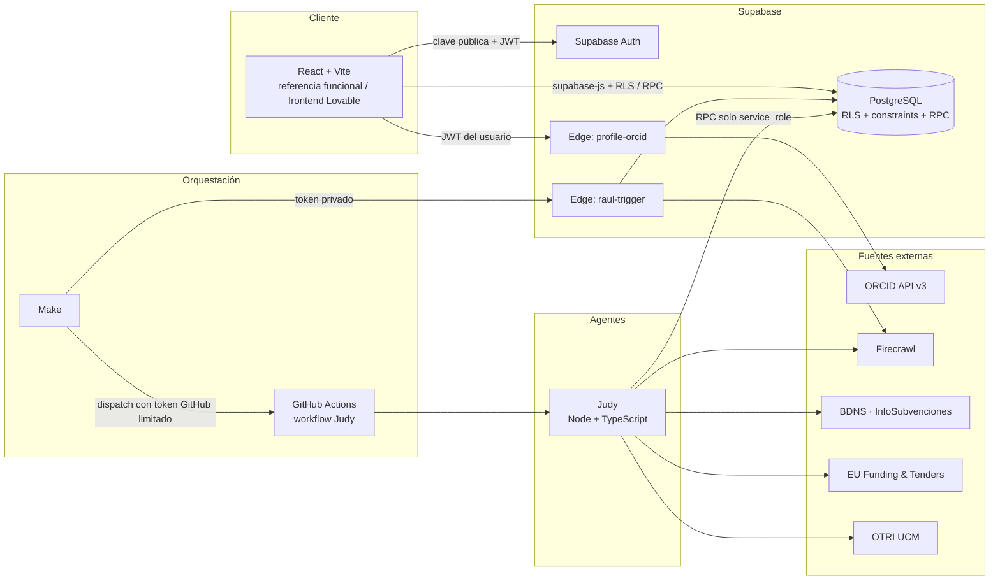

# NexoLab

> **Plataforma para acompañar toda la trayectoria investigadora**: desde descubrir la primera beca o práctica hasta encontrar colaboradores y financiación para un proyecto científico.

Proyecto del hackathon **AImpacto**. NexoLab conecta a estudiantes, investigadores y grupos de investigación en un único lugar, apoyándose en un catálogo de becas y convocatorias que mantienen agentes automáticos (**Raúl** y **Judy**) a partir de fuentes oficiales.

> ⚠️ **Estado: en desarrollo (hackathon).** Este README describe la arquitectura y el estado real de las ramas. Lo que no está desplegado ni verificado se marca como tal; consulta [Estado del proyecto](#estado-del-proyecto).

---

## Tabla de contenidos

1. [El problema y la propuesta](#el-problema-y-la-propuesta)
2. [Funcionalidades](#funcionalidades)
3. [Arquitectura](#arquitectura)
4. [Stack tecnológico](#stack-tecnológico)
5. [Estructura de carpetas](#estructura-de-carpetas)
6. [Modelo de datos](#modelo-de-datos)
7. [Seguridad y permisos](#seguridad-y-permisos)
8. [Los agentes: Raúl y Judy](#los-agentes-raúl-y-judy)
9. [Instalación y puesta en marcha](#instalación-y-puesta-en-marcha)
10. [Variables de entorno](#variables-de-entorno)
11. [Scripts disponibles](#scripts-disponibles)
12. [Pruebas y calidad](#pruebas-y-calidad)
13. [Integración con Make y Lovable](#integración-con-make-y-lovable)
14. [Ramas y flujo de trabajo](#ramas-y-flujo-de-trabajo)
15. [Estado del proyecto](#estado-del-proyecto)
16. [Hoja de ruta](#hoja-de-ruta)
17. [Documentación adicional](#documentación-adicional)
18. [Equipo](#equipo)

---

## El problema y la propuesta

Quien empieza en investigación se enfrenta a información dispersa: las becas, prácticas y convocatorias se publican en boletines oficiales, webs de universidades y fundaciones; los grupos de investigación no son fáciles de descubrir; y encontrar al colaborador adecuado depende de contactos personales.

NexoLab ofrece:

- **Un perfil investigador único** (una cuenta universal) que puede liderar varios grupos y pertenecer a otros.
- **Grupos y proyectos** descubribles por disciplinas, con un flujo de solicitudes de ingreso.
- **Necesidades de reclutamiento y diagnóstico explicable**: la persona comprueba cómo encaja su perfil con lo que busca un proyecto (sin rankings globales de personas).
- **Catálogo de becas, prácticas y financiación** alimentado por agentes y consultado desde la base de datos, **sin scraping ni LLM en cada búsqueda del usuario**.

### Principios de diseño

| Principio | Qué significa |
| --- | --- |
| Determinista primero | M1 no usa IA en las búsquedas; los matchings son explicables por relaciones canónicas de temas y capacidades. |
| La base de datos manda | Autorización e integridad críticas se aplican en SQL (RLS, constraints, RPC transaccionales), además de la validación de formularios. |
| Nada simulado | Si una integración no está configurada, la aplicación lo dice; no se finge persistencia ni éxito. |
| Desconocido ≠ incompatible | La elegibilidad distingue *compatible*, *incompatible* y *desconocido* por criterio. |
| Privacidad por defecto | Perfiles privados por defecto; los datos privados no se filtran por relaciones indirectas. |
| Sin secretos en el cliente | Solo variables `VITE_*` públicas en el navegador; claves de servicio únicamente en servidores/CI. |

---

## Funcionalidades

**Colaboración (M1)**

- Registro, inicio de sesión y recuperación de contraseña (Supabase Auth).
- Perfil con institución, país, etapa académica, bio, competencias y disciplinas; privado por defecto.
- **Importación de perfil** (nunca se guarda automáticamente; hay vista previa editable):
  - **ORCID**: Edge Function que consulta la API pública v3.0 con credenciales solo en servidor y valida el checksum ISO 7064 MOD 11-2.
  - **LinkedIn**: solo export ZIP/CSV descargado por la persona, procesado en memoria en el navegador.
- Grupos de investigación (públicos/privados), con propietario único y administradores/miembros.
- Solicitudes de ingreso con aprobación/rechazo/cancelación transaccional e historial inmutable.
- Proyectos de investigación (borrador/activo/completado), con financiación necesaria opcional.
- Descubrimiento de grupos por texto y disciplina (`discover_groups`).

**Matching y diagnóstico**

- **Necesidades de reclutamiento** de un grupo o proyecto, con competencias requeridas.
- **Diagnóstico personal**: cobertura de competencias requeridas/coincidentes/ausentes/adicionales sobre el perfil propio, con `algorithm_version` y snapshot reproducible.
- **Feedback** (`útil` / `no útil`) sobre cada recomendación mostrada.

**Becas y financiación**

- Catálogo de oportunidades (`/scholarships`) con filtros, paginación y detalle.
- Evaluación de elegibilidad por criterio (compatible / incompatible / desconocido) contra el perfil propio.
- Ingesta automática por **Raúl** (becas y prácticas) y **Judy** (convocatorias de financiación).

---

## Arquitectura



### Capas

1. **Frontend (React + TypeScript estricto)**: organizado por *feature*. Habla con Supabase usando únicamente la clave pública y el JWT del usuario. El React del repositorio es una **referencia funcional**; el frontend definitivo se construye en **Lovable** contra los mismos contratos.
2. **Supabase (única persistencia y Auth)**: PostgreSQL aplica RLS, constraints y transacciones. Las operaciones compuestas son RPC (guardar entidad y temas, aprobar solicitud y crear membresía, etc.). No hay backend duplicado, Redis ni microservicios.
3. **Edge Functions (Deno)**:
   - `profile-orcid`: importa datos públicos de ORCID (requiere sesión del usuario).
   - `raul-trigger`: dispara y consulta ejecuciones del agente Raúl (autenticada con token privado, `verify_jwt=false`).
4. **Agentes de ingesta**: Raúl (Edge Function) y Judy (proceso Node en GitHub Actions). Escriben el catálogo mediante RPC reservadas a `service_role`.
5. **Orquestación**: Make decide *cuándo* se ejecutan y a quién se avisa; **no** recibe `service_role` ni escribe tablas directamente.

### Flujo de datos del catálogo

```
Fuentes oficiales/APIs → ingesta programada → normalización + deduplicación + hash
  → PostgreSQL (opportunities + *_details + versiones)
  → filtros duros de elegibilidad → UI
```

La búsqueda de usuarios **solo lee datos persistidos**; no hay scraping ni llamadas a modelos por consulta.

---

## Stack tecnológico

| Área | Tecnología |
| --- | --- |
| Frontend | React 19, TypeScript 6 (estricto), Vite 8, Tailwind CSS 4, React Router 7, Zod 4, lucide-react |
| Backend | Supabase (Auth, PostgreSQL, PostgREST, Edge Functions en Deno) |
| Agente Judy | Node ≥ 22, TypeScript, Cheerio |
| Extracción web | Firecrawl (solo donde no hay API) |
| Orquestación | Make, GitHub Actions |
| Calidad | ESLint 10, Vitest 5, Testing Library, Playwright, pgTAP, PGlite, Deno check |
| Tipos | Contrato curado en `src/types/database.ts` + comprobación contra los tipos generados por la CLI |

---

## Estructura de carpetas

> Estado actual de `main`, que ya incluye el stack consolidado de la rama `integration/backend-lovable` (PR #1).

```text
.
├── src/                          # Frontend React (referencia funcional)
│   ├── app/
│   │   ├── providers/            # AuthProvider, contexto de sesión
│   │   └── routes/               # Rutas y ProtectedRoute
│   ├── components/               # Layout y controles UI reutilizables
│   ├── features/                 # Servicios y pantallas por feature
│   │   ├── auth/                 # Login, registro, recuperación, /setup
│   │   ├── discovery/            # Landing, dashboard, explorar
│   │   ├── groups/               # Grupos de investigación
│   │   ├── memberships/          # Solicitudes de ingreso
│   │   ├── profiles/             # Perfil + import/ (ORCID, LinkedIn)
│   │   ├── projects/             # Proyectos de investigación
│   │   ├── matching/             # Necesidades, diagnóstico y feedback
│   │   └── scholarships/         # Catálogo de becas/financiación y elegibilidad
│   ├── hooks/                    # useResource, useMutationIdentity
│   ├── lib/
│   │   ├── supabase/             # Cliente, config, api, catalog, identity
│   │   ├── validation/           # Esquemas Zod
│   │   └── errors/               # Mensajes de error
│   ├── types/                    # database.ts (contrato SQL), automations.ts
│   └── styles/
├── supabase/
│   ├── config.toml               # Configuración del stack local
│   ├── migrations/               # Fuente de verdad del esquema (versionadas)
│   ├── functions/                # Edge Functions
│   │   ├── _shared/              # Utilidades ORCID compartidas
│   │   ├── profile-orcid/
│   │   └── raul-trigger/
│   ├── seed.sql                  # Datos de demostración (solo local)
│   └── tests/                    # pgTAP: colaboración, Raúl, financiación
├── agents/
│   └── judy/                     # Agente de convocatorias de financiación
│       ├── src/                  # cli, pipeline, runner, server, sources/, store/, util/
│       ├── config/               # private-sources.json
│       ├── sql/                  # SQL legado (NO aplicar; ver migraciones canónicas)
│       └── tests/                # Fixtures reales + PGlite
├── tests/
│   ├── frontend/                 # Vitest: componentes, validación, importaciones, agentes
│   ├── database/                 # Esquema, RLS, concurrencia (PostgreSQL embebido)
│   ├── integration/              # Auth/REST/Edge contra Supabase local
│   ├── e2e/                      # Playwright
│   └── fixtures/
├── docs/                         # Documentación técnica detallada
├── .github/workflows/            # ci.yml (calidad) y judy.yml (ingesta diaria)
├── AGENTS.md                     # Instrucciones para agentes de código del repo
├── .env.example                  # Variables públicas del frontend
└── package.json
```

---

## Modelo de datos

Las migraciones de `supabase/migrations/` son la fuente de verdad, en este orden:

| Migración | Contenido |
| --- | --- |
| `20261016222019_nexolab_m1` | `profiles`, `research_groups`, `group_memberships`, `group_join_requests`, `research_projects`, `topics` y tablas N:M (`profile_topics`, `group_topics`, `project_topics`) |
| `20261017010000_matching_diagnostics_feedback` | `recruitment_needs`, `recommendation_events`, `recommendation_feedback` |
| `20261017020000_raul_opportunities` | `opportunity_sources`, `opportunities`, `scholarship_details`, `opportunity_versions`, `raul_runs`, `raul_source_runs` |
| `20261017093053_funding_catalog_judy` | `funding_details`, `judy_runs`, `judy_run_batches` y RPC de Judy |

Puntos clave:

- `research_groups.owner_id` es la **única** fuente de propiedad; el propietario no se duplica en `group_memberships`.
- `academic_stage` **describe a la persona**, nunca concede permisos.
- El catálogo `opportunities` usa `(source_id, external_id)` como identidad estable, guarda un hash factual, `content_version` y un historial en `opportunity_versions`.
- Los detalles específicos viven en `scholarship_details` (Raúl) y `funding_details` (Judy); no se mezclan.
- Taxonomía N:M con identificadores canónicos para filtros y recomendaciones explicables.

---

## Seguridad y permisos

- **RLS y grants mínimos** en todas las tablas expuestas; grants y policies se definen juntos.
- **RPC transaccionales** para solicitudes y escrituras con taxonomía; estado terminal inmutable y unicidad de solicitudes pendientes/membresías.
- `SECURITY DEFINER` solo donde es imprescindible: esquema privado, `search_path` seguro, identidad comprobada con `auth.uid()` y `EXECUTE` restringido; wrappers públicos con `SECURITY INVOKER`.
- Nunca se usa `user_metadata` para permisos.
- Las RPC de ingesta (Judy/Raúl) solo se conceden a `service_role`; ni Make ni el frontend reciben claves de servicio.
- Sin borrados destructivos del historial científico.

Resumen de permisos (detalle completo en [docs/permissions.md](docs/permissions.md)):

| Operación | Público | Usuario | Propietario | Admin | Miembro |
| --- | :-: | :-: | :-: | :-: | :-: |
| Leer perfil | Solo público | Propio | Sin excepción a privacidad | Sin excepción | Sin excepción |
| Leer grupo/proyecto | Solo públicos | Según relación | ✅ | ✅ | ✅ |
| Editar grupo | ❌ | – | ✅ | ❌ | ❌ |
| Crear/editar proyectos | ❌ | – | ✅ | ✅ | ❌ |
| Solicitar ingreso | ❌ | A grupo público abierto | – | – | – |
| Aprobar/rechazar solicitud | ❌ | Nunca autoaprobar | ✅ | ✅ | ❌ |

---

## Los agentes: Raúl y Judy

Comparten el catálogo normalizado de oportunidades pero tienen alcances distintos.

### Raúl · becas y prácticas de investigación

Orientado a estudiantes y nuevos investigadores. Se ejecuta como **Edge Function `raul-trigger`**.

- Fuentes activas (Firecrawl sobre páginas oficiales): IMDEA Energía, UPM (metrología) y RTVE (TFM). BOE y BDNS están registradas como *planificadas*, sin ingesta.
- Límite por ejecución: **3 páginas / 3 créditos estimados**, proxy `basic`, timeout de 12 s por llamada.
- Idempotencia por `request_id`; un único lote activo global.
- Fallos de extracción → `pending_review`; nunca se infieren requisitos.
- Disparo: `POST /functions/v1/raul-trigger` con la cabecera `x-raul-trigger-key`; consulta con `GET ...?run_id=<uuid>`.

| Código | Significado |
| :-: | --- |
| 200 | Completado |
| 202 | Reintento de un lote en curso |
| 207 | Parcial |
| 401 | Token ausente o incorrecto |
| 429 | Hay otra ejecución activa |
| 5xx | Fallo de backend/configuración |

Detalle en [docs/raul.md](docs/raul.md).

### Judy · convocatorias de financiación

Busca, normaliza y guarda convocatorias de financiación para investigación en Supabase. **No hace matching**: su trabajo es que la base tenga convocatorias reales, al día y con su fuente oficial.

| Fuente | Tipo | Método |
| --- | --- | --- |
| `bdns` | Pública (España) | API de InfoSubvenciones; solo concurrencia competitiva en I+D+i |
| `eu_funding_tenders` | Pública (UE) | Search API de la Comisión (topics de Horizon Europe) |
| `ucm_otri` | Privada (agregador) | HTML de la página de la OTRI/OTC de la UCM |
| `private_web` | Privada | Firecrawl (opt-in explícito) con barrera anti-alucinación |

Garantías de calidad: estado calculado por fechas (plazos en hora de Madrid), plazos sin fecha → `unknown`, descarte de convocatorias cuyo título o enlace no aparezcan en la página, `robots.txt` y *rate limiting* educado, idempotencia por `request_id` y por `(source, external_id)` + hash de contenido. La persistencia va en lotes acotados con claves inmutables (reintentos seguros), un único job activo con *lease* y artifacts de diagnóstico con errores redactados. Más detalle en [agents/judy/README.md](agents/judy/README.md).

Ejecución recomendada: **GitHub Actions** (`.github/workflows/judy.yml`, diario a las 05:15 UTC y `workflow_dispatch`), sin servidor permanente. Opcionalmente existe un servidor Node (`npm run serve`) para un host de confianza.

---

## Instalación y puesta en marcha

### Requisitos

- **Git**
- **Node.js 24.x** y npm (el frontend exige `>=24 <25`; Judy requiere `>=22`)
- **Docker Desktop** con motor Linux (stack local de Supabase; la CLI ya es dependencia de desarrollo, no hace falta instalarla globalmente)
- Puertos libres: `5173` (frontend), `54321` (API), `54322` (PostgreSQL), `54323` (Studio)
- *(Opcional)* **Deno** para `typecheck:edge`

### Pasos (PowerShell)

```powershell
git clone https://github.com/nik-ilin/Hackathon-AImpacto.git
cd Hackathon-AImpacto

npm ci
npm run db:start            # arranca Supabase local (Docker)
npm run db:reset            # aplica migraciones + seed (BORRA datos del stack local)
Copy-Item .env.example .env.local
notepad .env.local          # pegar la clave publishable del stack local
npm run dev
```

Abre <http://127.0.0.1:5173>. Studio local: <http://127.0.0.1:54323>.

- En `.env.local` usa `VITE_SUPABASE_URL=http://127.0.0.1:54321` y la clave **publishable/anon** que imprime `db:start`. **Nunca** la `secret` ni `service_role`.
- Reinicia Vite tras cambiar variables.
- Sin configuración, la app muestra una guía en `/setup`; no existe persistencia simulada.

### Ejecutar Judy en local

```powershell
cd agents\judy
npm ci
npm test
npm run collect -- --dry-run --out data     # todas las fuentes, sin guardar en BD
npm run collect -- --sources bdns,eu_funding_tenders --since-days 60
```

### Probar la importación ORCID en local

```powershell
Copy-Item supabase\functions\.env.example supabase\functions\.env   # completar credenciales ORCID
npx supabase functions serve profile-orcid --env-file supabase/functions/.env
```

### Parar el stack local

```powershell
npx supabase stop
```

### Sin Docker

Se pueden ejecutar frontend, `typecheck`, `lint`, `build`, Vitest (PostgreSQL embebido con PGlite) y E2E público. No se puede verificar el stack completo Auth/PostgREST ni la concurrencia multiconexión.

---

## Variables de entorno

| Variable | Dónde | Uso |
| --- | --- | --- |
| `VITE_SUPABASE_URL` | Frontend | URL pública del proyecto Supabase |
| `VITE_SUPABASE_PUBLISHABLE_KEY` | Frontend | Clave publishable/anon (**nunca** secret/service_role) |
| `ORCID_CLIENT_ID`, `ORCID_CLIENT_SECRET` | Secretos de Edge Functions | Token `/read-public` de ORCID |
| `RAUL_TRIGGER_TOKEN` | Edge Functions + conexión privada de Make | Autentica `raul-trigger` |
| `FIRECRAWL_API_KEY` | Edge Functions (Raúl) y Actions (Judy, opcional) | Extracción web |
| `SUPABASE_URL`, `SUPABASE_SERVICE_ROLE_KEY` | Secretos de GitHub Actions / servidor | Persistencia privilegiada de Judy; **no entregar a Make** |
| `ANTHROPIC_API_KEY`, `JUDY_LLM_MODEL` | Secretos Actions (opcional) | Extracción privada con LLM alternativa a Firecrawl |
| `JUDY_API_KEY` | Solo si se aloja el servidor Judy | Autentica `POST /run` y `GET /runs/<id>` |

Los valores reales **nunca** se versionan: `.env.local` y `supabase/functions/.env` están ignorados por Git.

---

## Scripts disponibles

| Script | Descripción |
| --- | --- |
| `npm run dev` | Servidor de desarrollo Vite (127.0.0.1) |
| `npm run build` | `tsc -b` + build de producción |
| `npm run preview` | Previsualiza el build |
| `npm run typecheck` / `typecheck:edge` / `typecheck:judy` | Comprobación de tipos (frontend, Edge con Deno, Judy) |
| `npm run lint` | ESLint sin warnings |
| `npm test` | Vitest (frontend + PostgreSQL embebido) |
| `npm run test:judy` | Pruebas del agente Judy |
| `npm run test:db` | pgTAP contra Supabase local |
| `npm run test:concurrency` | Concurrencia con conexiones PostgreSQL independientes |
| `npm run test:integration` | Auth/REST/RPC reales contra Supabase local |
| `npm run test:profile-import-edge` | Edge `profile-orcid` local |
| `npm run test:edge:local` | Edge Functions locales |
| `npm run test:catalog:integration` / `test:catalog:concurrency` | Catálogo de becas y financiación |
| `npm run test:db:types` | Compara tipos curados con los generados por la CLI |
| `npm run test:e2e` / `test:e2e:local` | Playwright (público / flujo completo con dos cuentas) |
| `npm run db:start` / `db:reset` / `db:types` | Stack local de Supabase, reseteo y generación de tipos |

---

## Pruebas y calidad

Antes de abrir una PR:

```powershell
npm run typecheck
npm run lint
npm test
npm run build
npm run test:judy
```

Con Supabase local iniciado:

```powershell
npm run test:db
npx supabase db lint --local --level warning --fail-on warning
npx supabase db advisors --local --type security --level warn --fail-on error
npm run test:concurrency
npm run test:integration
npm run test:e2e:local
```

El **CI** (`.github/workflows/ci.yml`, en `pull_request` y manual) ejecuta typecheck, lint, tests, build, Deno check y los tests de Judy; incluye un job con Supabase local. El workflow `judy.yml` realiza la ingesta diaria.

> Los runners de integración solo admiten *loopback* y no usan `service_role`. **Nunca** apuntarlos a producción. `npm test` con PostgreSQL embebido **no sustituye** la prueba del stack Auth/PostgREST ni la concurrencia real.

---

## Integración con Make y Lovable

**Make orquesta, no escribe.** Dispara a los agentes y notifica; no recibe `service_role`.

- **Raúl**: `POST https://<PROJECT_REF>.supabase.co/functions/v1/raul-trigger` con `x-raul-trigger-key` y un `request_id` estable para reintentos; después `GET ?run_id=<uuid>`.
- **Judy**: `POST` al endpoint `workflows/judy.yml/dispatches` de la API de GitHub con un *fine-grained token* de **Actions: Read and write** limitado a este repositorio. Un `204` solo confirma que se aceptó el dispatch, no que la ingesta haya terminado; hay que consultar el run y su artifact `run.json`.

**Lovable**: el frontend definitivo se conecta al **proyecto Supabase existente** (no crear otro proyecto ni habilitar Lovable Cloud), con solo las dos variables públicas `VITE_*`. Las migraciones de este repositorio son la autoridad del esquema. Contratos RPC, tablas legibles, ejemplos de código y manejo de errores en [docs/lovable-backend-handoff.md](docs/lovable-backend-handoff.md).

---

## Ramas y flujo de trabajo

`main` incluye ya el stack completo (M1, importaciones, matching, Raúl y Judy), integrado mediante PRs. El resto de ramas son el historial de ese trabajo:

| Rama | Contenido |
| --- | --- |
| `main` | Rama principal con el stack consolidado |
| `feature/bootstrap-infrastructure` | M1: infraestructura base (React, Supabase, migración M1, pruebas) |
| `fix/m1-review-findings` | Correcciones de la revisión de M1 + regresiones |
| `feature/profile-imports` | Importación de perfil desde ORCID y LinkedIn |
| `codex/matching-diagnostics-feedback` | Necesidades de reclutamiento, diagnóstico de encaje y feedback |
| `codex/raul-scholarships` | Agente Raúl (monitor de becas) e integración con matching |
| `feature/judy-recopilador` | Agente Judy: fuentes, pipeline, SQL/RLS aislado, tests con fixtures reales |
| `integration/backend-lovable` | Consolidación de todo lo anterior + migración canónica de financiación + guía para Lovable |
| `fix/judy-production-diagnostics` | Diagnósticos de ingesta de Judy: lotes acotados y errores redactados (PR #5) |

### Convenciones

- Partir de `main` actualizado, trabajar en ramas `feature/*` o `fix/*` y abrir PR con problema, comportamiento resultante, migraciones y pruebas ejecutadas. Requiere revisión independiente y CI verde antes del merge.
- No hacer force-push ni reescribir ramas compartidas.
- No editar migraciones ya compartidas: crear una nueva con `npx supabase migration new <nombre>` y regenerar/revisar tipos (`npm run db:types`).
- Interfaz en español, controles HTML accesibles, código modular por *feature*.
- Orden de migraciones al consolidar: M1 → matching → Raúl → financiación/Judy. **No** aplicar `agents/judy/sql/` (SQL legado).

---

## Estado del proyecto

Resumen honesto, según [docs/backend-readiness.md](docs/backend-readiness.md):

| Subsistema | Implementado | Verificado en local | Desplegado |
| --- | :-: | :-: | :-: |
| Auth, perfiles, grupos, proyectos, solicitudes | ✅ | ✅ (SQL embebido + frontend) | ❌ |
| Matching y feedback | ✅ | ✅ | ❌ |
| Importación ORCID / LinkedIn | ✅ | ✅ (con mocks) | ❌ |
| Catálogo de becas y financiación | ✅ | ✅ | ❌ |
| Raúl (Edge + RPC) | ✅ | ✅ (mocks + SQL) | ❌ |
| Judy (fuentes, pipeline, workflow) | ✅ | ✅ (fixtures reales) | ❌ |
| Escenarios Make | Documentados | – | ❌ |
| Frontend Lovable | Guía y contratos | – | ❌ |

**Pendiente antes de producción**: CI completo sobre la integración consolidada, pruebas Auth/REST/concurrencia con Supabase real, aplicar migraciones al proyecto remoto (con autorización), desplegar Edge Functions y secretos, configurar URLs de Auth definitivas y hacer una ejecución real controlada de cada agente.

### Limitaciones conocidas

- La importación ORCID por iD manual **no verifica titularidad**.
- BOE y BDNS están planificadas en Raúl, sin ingesta activa.
- La elegibilidad con datos insuficientes queda como *desconocida*; no se deduce Grado/Máster ni residencia a partir de `student`.
- El bundle JS supera los 500 kB (aviso de Vite).

---

## Hoja de ruta

- [x] **M1**: perfiles, grupos, solicitudes y proyectos
- [x] Importación de perfil (ORCID, LinkedIn)
- [x] Necesidades de reclutamiento, diagnóstico y feedback
- [x] Catálogo de becas (Raúl) y financiación (Judy)
- [ ] Conectar el frontend Lovable al backend
- [ ] Despliegue en Supabase y escenarios Make reales
- [ ] Ingesta BOE/BDNS en Raúl
- [ ] Reglas de elegibilidad versionadas y *matching* semántico opcional (proyectos ↔ convocatorias)
- [ ] Interfaz de voz (ElevenLabs)
- [ ] Observabilidad de ingestas: coste, latencia, frescura y alertas

---

## Documentación adicional

| Documento | Contenido |
| --- | --- |
| [docs/architecture.md](docs/architecture.md) | Arquitectura de M1 |
| [docs/database.md](docs/database.md) | Esquema de base de datos |
| [docs/permissions.md](docs/permissions.md) | Matriz de permisos e invariantes |
| [docs/setup.md](docs/setup.md) | Puesta en marcha en Windows/PowerShell |
| [docs/decisions.md](docs/decisions.md) | Decisiones de diseño |
| [docs/profile-imports.md](docs/profile-imports.md) | Importación ORCID/LinkedIn |
| [docs/raul.md](docs/raul.md) | Agente Raúl y contrato con Make |
| [docs/future-agents.md](docs/future-agents.md) | Diseño de los agentes de becas/financiación |
| [docs/integrations.md](docs/integrations.md) | Estado de integraciones |
| [docs/lovable-backend-handoff.md](docs/lovable-backend-handoff.md) | Contrato backend para Lovable |
| [docs/backend-readiness.md](docs/backend-readiness.md) | Evidencia de preparación y matriz de estado |
| [docs/verification.md](docs/verification.md) | Resultados de verificación |
| [agents/judy/README.md](agents/judy/README.md) | Agente Judy |
| [AGENTS.md](AGENTS.md) | Convenciones para agentes de código |

---

## Equipo

Proyecto desarrollado durante el hackathon **AImpacto** por el equipo de NexoLab.

| Contribuidor | Áreas principales (según el historial de Git) |
| --- | --- |
| Javier Gonzálvez | Infraestructura M1, importación de perfil, Raúl, integración backend |
| Samuel Izquierdo (Saizsa) | Agente Judy |
| Nikolai Ilin (nik-ilin) | Matching/diagnóstico y Raúl |
| Jonnathan Ospina | Contribuciones al repositorio |

---

## Licencia

Pendiente de definir.
