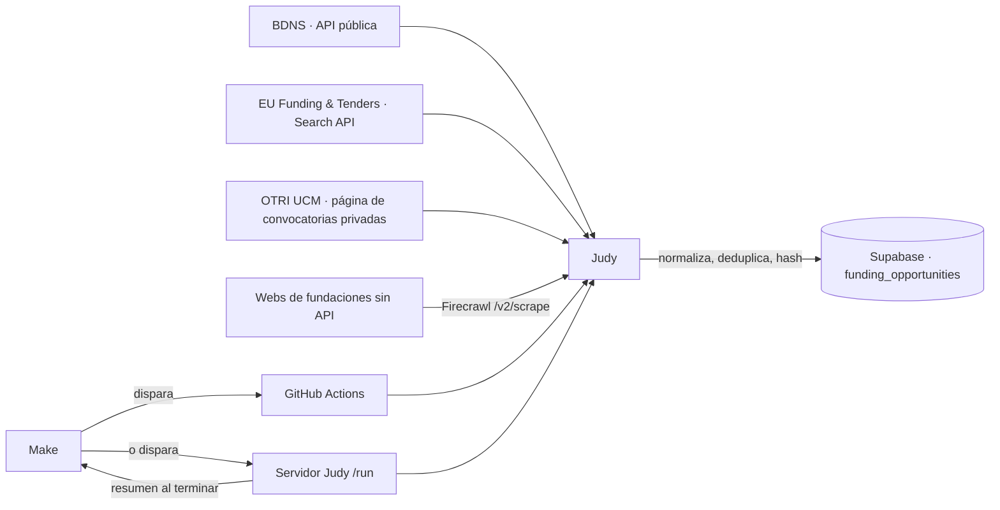

# Judy · recopilación de convocatorias de financiación

Judy es el agente de NexoLab que **busca, descarga y normaliza convocatorias de financiación para la investigación**, públicas y privadas, y las guarda en Supabase. No hace matching ni recomendaciones: su trabajo es que la base de datos tenga convocatorias reales, actualizadas y con su fuente oficial.



## Fuentes

| Fuente | Tipo | Qué recoge | Cómo |
| --- | --- | --- | --- |
| `bdns` | Pública, España (Estado, CC. AA., entidades locales, universidades) | Convocatorias con finalidad "Investigación, desarrollo e innovación" (id 17) de los últimos N días, solo de **concurrencia competitiva** (descarta concesiones directas y nominativas, que no se pueden solicitar) | API REST abierta de InfoSubvenciones (`/convocatorias/busqueda` + `/convocatorias?numConv=`) |
| `eu_funding_tenders` | Pública, UE | *Topics* abiertos y próximos de Horizon Europe (configurable por programa), con presupuesto, importe por proyecto y plazos | Search API de la Comisión (`apiKey=SEDIA`) |
| `ucm_otri` | Privada (agregador) | Convocatorias de fundaciones que publica la OTRI/OTC de la UCM ("la Caixa", AECC, Ramón Areces, MAPFRE…), con el enlace oficial de la fundación, el plazo del organismo y el plazo interno UCM | HTML estructurado de la página |
| `private_web` | Privada | Convocatorias de las webs de fundaciones listadas en `config/private-sources.json` | **Firecrawl**: una llamada `/v2/scrape` por página que devuelve markdown, enlaces y la extracción estructurada con el esquema de Judy. Sin Firecrawl, alternativa con descarga directa y Claude (`ANTHROPIC_API_KEY` y `JUDY_LLM_MODEL`). Sin ninguna de las dos, se omite con aviso |

**Verificado el 17/10/2026 contra las fuentes reales:**

- **BDNS:** 485 convocatorias de I+D+i registradas en 120 días. En una muestra de 120, 47 eran de concurrencia competitiva y 18 estaban abiertas.
- **UE:** 807 *topics* de Horizon Europe abiertos o próximos.
- **OTRI UCM:** 10 tarjetas de convocatorias.

Los tests usan respuestas reales capturadas ese día.

## Firecrawl: dónde se usa y cuánto cuesta

Se usan APIs cuando existen (BDNS, EU Funding & Tenders) o HTML estructurado (OTRI UCM), que son gratuitos. **Firecrawl solo se usa para webs de fundaciones sin API.**

- **Una llamada por página:** `formats: ["markdown", "links", {type: "json", schema, prompt}]`. El esquema es el mismo que Judy valida después.
- **Coste por página:** según la [documentación de Firecrawl](https://docs.firecrawl.dev/features/scrape), 1 crédito por *scrape* + 4 por el modo JSON = **5 créditos**. Con las 4 páginas de ejemplo y una ejecución diaria, unos 20 créditos al día.
- **Caché:** `maxAge` es de 24 horas por defecto (`FIRECRAWL_MAX_AGE_MS`). Si Make o GitHub Actions lanzan a Judy varias veces el mismo día, Firecrawl devuelve su caché en vez de volver a rastrear.
- **Cero rastreo por usuario:** los agentes y la web solo leen Supabase.
- **La IA de Firecrawl no tiene la última palabra:** Judy descarta cualquier convocatoria cuyo título no esté en el markdown devuelto, o cuyo enlace no esté en la lista de enlaces de la página.

Para añadir una fundación, agrega una entrada a `config/private-sources.json` y revisa a mano el resultado de la primera ejecución en `data/opportunities.csv`.

## Garantías de calidad

- **Estado calculado por fechas.** El indicador `abierto` de BDNS y el estado del portal UE a veces no coinciden con el plazo real.
- **Plazos en hora de Madrid.** "3/11/2026" significa hasta las 23:59:59 de ese día.
- **Plazos sin fecha.** Cuando la fuente solo da un texto ("20 días hábiles desde la publicación"), se guarda en `deadline_text` y el estado queda `unknown`.
- **Barrera anti-alucinación** en `private_web`, con Firecrawl o con Claude: se descarta cualquier convocatoria cuyo título no aparezca literalmente en la página, y cualquier enlace que la página no contenga. Un importe sin moneda explícita no se guarda.
- **Fetch educado:** Judy se identifica con su User-Agent, respeta `robots.txt` en las webs (las APIs públicas documentadas están exentas), deja 400 ms entre peticiones al mismo dominio y reintenta con espera exponencial solo ante 429/5xx.
- **Idempotencia:** clave `(source, external_id)` y un hash de contenido que ignora el estado. Repetir la ejecución no duplica nada y `last_changed_at` solo cambia si cambia el contenido.
- **Licencias:** los datos de BDNS se reutilizan citando a la IGAE (va en `raw.fuente`). En las webs privadas, solo páginas públicas y respetando sus condiciones.

## Puesta en marcha

```bash
cd agents/judy
npm install   # genera package-lock.json: conviene subirlo al repo
npm test                      # 27 pruebas: fuentes, Firecrawl simulado, utilidades y SQL (PGlite)
npm run collect -- --dry-run --out data            # todas las fuentes, sin guardar en BD
npm run collect -- --sources bdns,eu --since-days 60 --max 200
```

Requiere Node 22 o superior. Los archivos de `data/` (`opportunities.json`, `opportunities.csv`, `report.json`) sirven para revisar a mano o para la demo.

### Supabase

1. Ejecuta `sql/001_judy_funding_sources.sql` en el SQL Editor (o cópialo a `supabase/migrations/` cuando la infraestructura esté en `main`). Crea:
   - `funding_opportunities`: lectura pública y escritura solo de servicio.
   - `judy_runs`: el historial de ejecuciones.
   - La vista `funding_opportunities_live`: estado recalculado y solo convocatorias vistas en los últimos 14 días.
   - Las funciones `judy_upsert_opportunities` y `judy_record_run`, ejecutables solo con la clave de servicio.
2. Define `SUPABASE_URL` y `SUPABASE_SERVICE_ROLE_KEY` (ver `.env.example`). La clave de servicio **nunca** va al frontend.

La web (Lovable o React) lee con la clave pública:

```ts
const { data } = await supabase.from("funding_opportunities_live")
  .select("*").in("live_status", ["open", "forthcoming"]).order("deadline_at");
```

## Conexión con Make

### Opción A (recomendada, sin servidor): Make → GitHub Actions

El workflow `.github/workflows/judy.yml` se ejecuta cada día a las 05:15 UTC y también se puede lanzar a mano.

1. En GitHub › Settings › Secrets › Actions, crea `SUPABASE_URL`, `SUPABASE_SERVICE_ROLE_KEY` y `FIRECRAWL_API_KEY`, y opcionalmente `ANTHROPIC_API_KEY` y `JUDY_LLM_MODEL`.
2. Crea un *fine-grained token* con permiso **Actions: Read and write**, solo sobre este repositorio, y guárdalo en Make como conexión o variable.
3. Escenario de Make:
   - **HTTP › Make a request**: `POST https://api.github.com/repos/nik-ilin/Hackathon-AImpacto/actions/workflows/judy.yml/dispatches`, con las cabeceras `Authorization: Bearer <token>` y `Accept: application/vnd.github+json`, y el cuerpo `{"ref":"main","inputs":{"sources":"bdns,eu_funding_tenders,ucm_otri","since_days":"60"}}`.
   - Unos minutos después (**Sleep** o un segundo escenario programado), lee las novedades: `GET {SUPABASE_URL}/rest/v1/funding_opportunities_live?live_status=eq.open&last_changed_at=gte.{{fecha}}&select=title,funder_name,deadline_at,url` con la clave publicable, y envíalas por email, Telegram o Slack.

**Por qué Firecrawl va dentro de Judy y no como módulo de Make:** Make tiene una app oficial de Firecrawl ("Scrape a Website", "Extract a Website"), pero si Make escribiera directamente en Supabase se saltaría la verificación anti-alucinación, la normalización de fechas y el hash que evita duplicados. Make orquesta (cuándo se ejecuta y a quién se avisa); Judy hace el trabajo.

### Opción B: servidor propio (Render, Railway, Fly…)

```bash
JUDY_API_KEY=<32+ caracteres> MAKE_CALLBACK_URL=<webhook de Make> npm run serve
```

| Ruta | Uso |
| --- | --- |
| `GET /health` | Comprobación sin clave |
| `POST /run` | Cabecera `x-judy-key`. Cuerpo opcional `{"sources":"bdns,eu_funding_tenders","sinceDays":60,"maxPerSource":300}`. Responde `202 {run_id}` y trabaja en segundo plano |
| `GET /runs/{id}` | Estado y resumen de una ejecución |

Al terminar, Judy hace `POST` del resumen a `MAKE_CALLBACK_URL`: estadísticas por fuente, totales guardados, errores y las 20 primeras convocatorias abiertas. En Make basta un **Custom webhook** que reciba ese JSON.

## Estructura

```
agents/judy/
  config/private-sources.json   páginas de fundaciones (extracción con LLM)
  sql/001_judy_funding_sources.sql
  src/types.ts                  contrato FundingOpportunity
  src/sources/                  bdns, euFundingTenders, ucmOtri, privateWeb
  src/util/http.ts              robots.txt, ritmo por dominio, reintentos
  src/util/text.ts              fechas, HTML, hash, URLs
  src/pipeline.ts               orquestación, deduplicación, CSV
  src/store/supabase.ts         RPC a Supabase con la clave de servicio
  src/cli.ts · src/server.ts    ejecución manual/programada y API para Make
  tests/                        fixtures reales + PGlite
```

## Limitaciones conocidas

- **BDNS** recoge solo la finalidad I+D+i. Algunas convocatorias de investigación se registran con otras finalidades (por ejemplo, Sanidad o Educación); se pueden añadir con `finalidad` en `collectBdns`.
- **UE:** por defecto solo Horizon Europe. Otros programas se añaden en `EU_PROGRAMMES`, con su identificador CCM2. Los resúmenes están en inglés.
- **`ucm_otri`** depende del HTML de esa página. Si la UCM cambia el diseño, el test con el fixture lo detectará al actualizarlo, y la ejecución lo mostrará como error, no como datos vacíos silenciosos.
- **`private_web`** necesita Firecrawl (o Claude) y una lista curada. Cada página nueva debe revisarse a mano la primera vez. Para descubrir subpáginas de convocatorias en webs grandes se podría añadir `/v2/map`; hoy se rastrea solo la URL configurada.
- No se ha ejecutado contra un Supabase real ni desde Make. La lógica SQL está probada con PGlite y las peticiones a las fuentes se verificaron desde un navegador.
