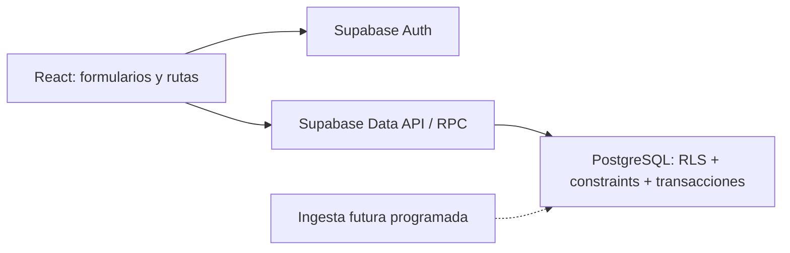

# Arquitectura M1

NexoLab acompaña toda la trayectoria investigadora: desde descubrir la primera oportunidad hasta conseguir colaboradores y financiación para proyectos científicos. M1 implementa colaboración determinista; becas, convocatorias y voz se incorporarán después.

El navegador ejecuta React, TypeScript estricto, Vite, Tailwind y React Router. Los servicios de cada feature llaman al cliente Supabase tipado. Supabase Auth mantiene sesiones; PostgreSQL aplica constraints, RLS, búsquedas y transacciones. No hay backend duplicado, caché distribuida ni IA en las búsquedas.

`src/app` compone rutas y proveedores; `src/components` mantiene controles reutilizables y layout; `src/features` agrupa servicios y pantallas; `src/lib` contiene configuración, validación y errores; `src/types/database.ts` refleja el contrato SQL. Las migraciones son la fuente de verdad del esquema.

El propietario se obtiene únicamente de `research_groups.owner_id`. Las membresías contienen colaboradores ya aceptados, con `admin` o `member`. No existe un rol global de estudiante/investigador. Los perfiles privados no se revelan por aparecer en un grupo; la UI usa un identificador cuando no puede leer el nombre.

Las mutaciones compuestas usan RPC: entidad y temas se guardan juntas; aprobar una solicitud crea una sola membresía y registra la decisión en la misma transacción. No se muestra éxito antes de recibir confirmación de PostgreSQL.

La aplicación sin configuración muestra instrucciones y no finge conexión. El cliente solo admite configuración pública. No se conectó ni modificó ningún proyecto remoto durante el desarrollo.

Referencias consultadas: [RLS de Supabase](https://supabase.com/docs/guides/database/postgres/row-level-security), [Auth con contraseña](https://supabase.com/docs/guides/auth/passwords), [CLI oficial](https://supabase.com/docs/reference/cli/introduction).
