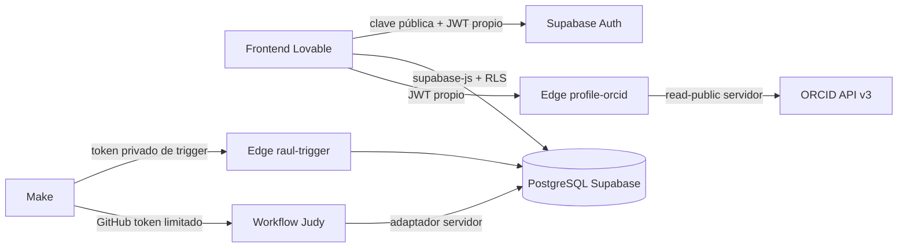

# NexoLab: contrato backend para Lovable

## Estado y alcance

Esta integración local parte de `origin/feature/profile-imports` (`158de82`) e incorpora una vez el delta Raúl `40e4204` sobre fix M1 `9720384`. Raúl contiene el matching de `69f5613` por copia, no por ascendencia. Judy procede de `5379e0e`. Las ramas de compañeros permanecen intactas. No se ha hecho commit, push, merge compartido, despliegue ni modificación remota.

El frontend Lovable se desarrolla por separado. Conectar sus pantallas a estos contratos; no crear otro catálogo, backend, proyecto Supabase ni sistema de autenticación. El React existente es una referencia funcional, no una plantilla que deba sustituir la interfaz Lovable.

## Arquitectura y proyecto existente



Proyecto confirmado mediante metadatos de solo lectura el 17-10-2026:

- Nombre: `Hackathon-AImpacto`.
- Referencia: `mcwoxcwpewghtmqlqtyb`.
- URL pública: `https://mcwoxcwpewghtmqlqtyb.supabase.co`.
- Dashboard: `https://supabase.com/dashboard/project/mcwoxcwpewghtmqlqtyb`.
- Región: `eu-west-1`.

La consulta remota devolvió **cero tablas públicas de aplicación, cero migraciones registradas y cero Edge Functions**. Una URL válida no significa que los contratos están desplegados. Ver [backend-readiness.md](backend-readiness.md) antes de conectar pantallas reales.

## Configuración pública y privada

| Variable | Dónde | Uso |
| --- | --- | --- |
| `VITE_SUPABASE_URL` | entorno frontend Lovable | URL pública anterior |
| `VITE_SUPABASE_PUBLISHABLE_KEY` | entorno frontend Lovable | clave publishable del mismo proyecto; nunca secret/service_role |
| `ORCID_CLIENT_ID`, `ORCID_CLIENT_SECRET` | secretos de Edge Functions | token de aplicación `/read-public`; no OAuth de usuario |
| `RAUL_TRIGGER_TOKEN` | Edge Functions y conexión HTTP privada de Make | autenticar todos los métodos de raul-trigger |
| `FIRECRAWL_API_KEY` | Edge Functions Raúl; secretos Actions Judy si se usa fuente privada | consultas permitidas de cada agente, nunca del navegador |
| `SUPABASE_URL`, `SUPABASE_SERVICE_ROLE_KEY` o `SUPABASE_SECRET_KEY` | runner servidor Judy/secretos Actions | persistencia canónica privilegiada; no entregar a Make |
| `ANTHROPIC_API_KEY`, `JUDY_LLM_MODEL` | secretos Actions Judy solo si se habilita extracción privada con LLM | opcional, no requerido para BDNS/UE/UCM ni para CI |
| `JUDY_API_KEY` | solo si se aloja servidor opcional Judy, y conexión privada Make | autenticar disparo y consulta |
| token GitHub con Actions write para este repositorio | conexión privada de Make | dispatch del workflow y lectura del run/artifact |

Los valores quedan como placeholders. Supabase inyecta su configuración interna en Edge; no copiar credenciales del servidor al cliente. No volcar `supabase status --output json`, variables de entorno o cabeceras en logs. El helper de pruebas extrae solo lo necesario en memoria y restringe los destinos a loopback.

## Conexión y sesiones

```ts
import { createClient } from '@supabase/supabase-js';
import type { Database } from './types/database';
const db = createClient<Database>(
  import.meta.env.VITE_SUPABASE_URL,
  import.meta.env.VITE_SUPABASE_PUBLISHABLE_KEY,
  { auth: { persistSession: true, autoRefreshToken: true, detectSessionInUrl: true } },
);
const signedUp = await db.auth.signUp({
  email, password,
  options: { emailRedirectTo: `${location.origin}/dashboard` },
});
const signedIn = await db.auth.signInWithPassword({ email, password });
await db.auth.resetPasswordForEmail(email, { redirectTo: `${location.origin}/reset-password` });
// Solo en el flujo de recuperación con sesión válida:
await db.auth.updateUser({ password: newPassword });
await db.auth.signOut();
```

Comprobar `error` en cada operación; `signUp` sin sesión requiere confirmación de email. No simular sesión ni guardado. Escuchar `onAuthStateChange`: mantener borradores en `TOKEN_REFRESHED` si `session?.user.id` no cambia; al cambiar de identidad incrementar un epoch y desmontar editores/resultados. El epoch también debe detectar A->B->A dentro de un batch. Cancelar cargas y descartar respuestas obsoletas. No hacer llamadas asíncronas Supabase dentro del callback síncrono de Auth.

Para mutaciones, reutilizar `src/lib/supabase/identity.ts`, `useMutationIdentity` y los servicios existentes: validan sesión/getUser y fijan `Authorization` al JWT de la identidad que comenzó la edición. Una comprobación de `session` en render no basta. RLS continúa siendo la autoridad final. Nunca usar `user_metadata` para permisos.

## Contratos de datos y permisos

Tipos mantenidos en `src/types/database.ts`; servicios en `src/lib/supabase/api.ts`, `catalog.ts`, `src/features/matching/service.ts` y `src/features/scholarships`. CI genera además el contrato oficial del esquema local para contrastar columnas y argumentos. Los tipos no sustituyen RLS.

| Recurso | Lectura frontend | Escritura y resultado |
| --- | --- | --- |
| `profiles`, `profile_topics`, `topics` | perfil propio; perfiles públicos según RLS; taxonomía canónica | `upsert_profile(...) -> void`, transaccional con topic IDs |
| `research_groups`, `group_topics` | públicos o grupos propios/con membresía | `save_research_group(...) -> uuid`, propietario; perfil obligatorio al crear |
| `research_projects`, `project_topics` | miembros del grupo, o proyecto público de grupo público | `save_research_project(...) -> uuid`, gestor del grupo |
| `group_memberships` | miembros según RLS; owner no se duplica como miembro | alta mediante aprobación de solicitud; no insertar desde cliente |
| `group_join_requests` | solicitante o gestores autorizados | `request_to_join`, `decide_join_request`, `cancel_join_request` -> fila de solicitud |
| `recruitment_needs` | ámbitos de grupo/proyecto visibles | `save_recruitment_need(...) -> uuid`, gestor |
| `recommendation_events` | solo actor | `diagnose_recruitment_need(...) -> snapshot`; `mark_recommendation_shown` -> void |
| `recommendation_feedback` | solo actor | `save_recommendation_feedback(...) -> void`, evento propio ya mostrado |
| `opportunities`, `opportunity_sources` | autenticados, fuente activa, frescura y plazos válidos | solo servicios de ingesta |
| `scholarship_details` | oportunidad visible | solo Raúl, no financiación |
| `funding_details` | oportunidad visible | solo adaptador Judy, no campos de beca |
| `opportunity_versions`, `raul_runs`, `raul_source_runs`, tablas de ejecución Judy | sin acceso frontend | servicio; Make consulta endpoint/Actions, no estas tablas |

`academic_stage` describe a la persona; no concede permisos. La propiedad deriva de `research_groups.owner_id`; los administradores de membresía gestionan únicamente lo permitido por SQL. No hay RPC de escritura arbitraria de membresías/roles en el cliente.

### Perfil e importaciones

`upsert_profile` recibe `p_full_name`, `p_username`, `p_institution`, `p_country`, `p_academic_stage`, `p_bio`, `p_skills: string[]`, `p_orcid_id`, `p_visibility`, `p_topic_ids: uuid[]`. Nombres/campos obligatorios y límites están en `profileSchema`; el servicio traduce cadenas vacías opcionales a null. Perfil nuevo privado por defecto.

Usar un único formulario para onboarding/edición. Cargar perfil y temas con estado loading/error; si falta perfil, redirigir a `/onboarding` preservando un retorno interno válido y evitando bucles. Crear grupo o solicitar incorporación exige volver a comprobar identidad y perfil.

```ts
const { data, error } = await db.functions.invoke('profile-orcid', {
  body: { orcidId: '0000-0002-1825-0097' },
});
// data = { source: 'ORCID', fields, context, topicHints }
// error: leer respuesta de la función de forma acotada; nunca guardar automáticamente.
```

ORCID valida checksum MOD 11-2 y URL. Nombre, institución inequívoca, país, bio e iD son propuestas; contexto no se guarda. Un iD manual no verifica titularidad. LinkedIn solo admite export ZIP/CSV reconocido y se procesa en memoria local. No enviar archivos a Supabase Storage. No se admiten experiencias, estudios o publicaciones como entidades persistidas en el perfil actual. Selección explícita de campos, edición de propuestas y confirmación antes del guardado; conservar valores manuales y visibilidad.

### Grupos, proyectos y solicitudes

```ts
const group = await db.rpc('save_research_group', {
  p_group_id: null, p_name: 'Grupo de investigación', p_description: 'Descripción',
  p_institution: null, p_country: null, p_visibility: 'private',
  p_accepting_members: true, p_topic_ids: [],
});
const request = await db.rpc('request_to_join', { p_group_id: groupId, p_message: 'Mi interés' });
const decision = await db.rpc('decide_join_request', { p_request_id: requestId, p_decision: 'approved' });
```

Estos fragmentos muestran el contrato RPC; el frontend debe fijar identidad como hacen los servicios. `save_research_project` añade `p_project_id`, `p_group_id`, `p_title`, `p_description`, `p_status: draft|active|completed`, `p_funding_needed_amount`, `p_funding_currency`, `p_visibility`, `p_topic_ids`. Importe y moneda se informan juntos. Un proyecto persistido público dentro de un grupo privado mantiene su valor, pero no se descubre públicamente; solo un cambio explícito debe modificar visibilidad.

Búsqueda: `discover_groups({p_search,p_topic_id,p_accepting,p_limit,p_offset})` devuelve grupos con `matched_topics:string[]` y `match_count:number`, sujeto a RLS. Parámetro `q` debe sincronizarse al navegar Atrás/Adelante, manteniendo edición antes del submit.

### Necesidades, diagnóstico y feedback

`save_recruitment_need`: `p_need_id|null`, `p_group_id`, `p_project_id|null`, `p_title`, `p_description`, `p_required_skills:string[]`, `p_status:open|closed`.

`diagnose_recruitment_need({p_need_id,p_impression_key:uuid})` devuelve `RecommendationEvent` con `context` y `evaluation`: capacidades requeridas/coincidentes/ausentes/adicionales, cobertura nullable y disciplinas coincidentes. El snapshot y `algorithm_version` explican el resultado observado. Es diagnóstico del perfil propio frente a una necesidad; no existe un endpoint de ranking global de candidatos.

Tras renderizar realmente, llamar `mark_recommendation_shown({p_event_id})`. Feedback: `save_recommendation_feedback({p_event_id,p_response:'useful'|'not_useful',p_comment})`. No reutilizar un impression key para otro contexto. El actor no puede leer ni comentar eventos de otra cuenta.

### Catálogo de becas y financiación

`listOpportunities(filters, identity)` en `src/lib/supabase/catalog.ts` acepta `page` (desde 0), `pageSize` (1..50, defecto12), `search` (título literal), `type`, `sourceId`, `country`, `status:open|forthcoming`. Devuelve `{items,page,pageSize,hasMore}`; pide un registro extra para detectar la siguiente página y ordena por plazo/id. `getOpportunityDetail(uuid,identity)` devuelve `{opportunity,source,scholarship,funding}` o null si no existe/no es visible. No necesita endpoints HTTP nuevos.

```ts
const { data, error } = await db.from('opportunities')
  .select('*').eq('opportunity_type', 'research_funding')
  .order('official_deadline_at', { ascending: true, nullsFirst: false })
  .order('id').range(0, 12); // 12 visibles + sentinel
const detail = await db.from('funding_details').select('*')
  .eq('opportunity_id', opportunityId).maybeSingle();
```

Identidad canónica `(source_id,external_id)`, hash factual calculado en SQL, snapshots versionados y checked_at independiente. Las fuentes pausadas o datos de más de14 días no aparecen en el catálogo público autenticado. `forthcoming` es próximo, no abierto. Un fallo de una fuente no refresca fichas no comprobadas ni borra convocatorias ausentes de una página parcial.

`funding_details` conserva tipo de financiador, procedencia, programa, identificador, instrumento, ámbito/regiones, beneficiarios/nota, moneda/presupuesto/importes/número de ayudas, texto del plazo, keywords, idioma y raw. No forzar financiación en `scholarship_details`. Importes y beneficiarios descritos no confirman elegibilidad del perfil: si faltan requisitos, estado **desconocido**. `assessment.ts` distingue compatible/incompatible/desconocido por criterio; no deduce Grado/Máster o residencia de la etapa student ni de competencias.

La fuente privada opcional se mantiene conservadora: hasta disponer de evidencia inequívoca por convocatoria, solo acepta título encontrado y URL HTTPS enlazada; fechas, importes y beneficiarios LLM quedan raw/unverified, estado unknown y fuera de la lectura pública. Nunca tomar hechos de otra convocatoria de la misma página como confirmados.

## Errores y estados de interfaz

| Caso | Manejo |
| --- | --- |
| Carga inicial / sesión pendiente | indicador loading; no mostrar controles autorizados prematuramente |
| Lista vacía | mensaje vacío real y filtros modificables; no rellenar demos remotos |
| Detalle null / permiso denegado | ausente/no disponible, sin revelar existencia privada |
| SQL `42501` / JWT inválido | revisar sesión/permisos, no reintentar como otro usuario |
| Validación Zod / `22023` / constraint | mostrar error accionable; conservar borrador propio |
| `23505` / conflicto transaccional | refrescar estado; no repetir indiscriminadamente una decisión terminal |
| HTTP429 | backoff, respetar Retry-After; mantener request_id |
| Edge503 con BOOT_ERROR | fallo de arranque, nunca autenticación exitosa |
| ORCID503 de configuración | servidor sin credenciales; no simular importación |
| Red/5xx | error y reintento explícito con la misma identidad e idempotency key |

Cancelar lecturas y descartar sus resultados al cambiar de cuenta. Evitar guardar snapshots privados en cachés compartidas sin userId+epoch. Nunca usar estado remoto success si el agente no ha persistido.

## Contrato Make: Raúl y Judy

Make orquesta; no recibe service_role, no escribe tablas ni evita validación de ingesta.

**Raúl**: POST `https://<SUPABASE_REF>.supabase.co/functions/v1/raul-trigger`, cabeceras `Content-Type: application/json`, `x-raul-trigger-key: <RAUL_TRIGGER_TOKEN>`, opcional `x-raul-request-id: <REQUEST_ID>`; cuerpo `{"mode":"incremental","max_sources":3,"request_id":"raul_20261017_daily"}`. Misma clave en reintentos, clave nueva para nueva ejecución deliberada; parámetros distintos con la misma clave se rechazan. GET a la misma URL con `?run_id=<UUID>` y la misma cabecera privada. `verify_jwt=false` solo para este endpoint porque valida token privado antes de todas las rutas; no copiar esa configuración a ORCID.

200 = completed, 202 = running, 207 = partial, 401 = token ausente/incorrecto, 429 = otra ejecución activa, 5xx = fallo/configuración/persistencia. Consultar `run_id`, `status`, resumen y códigos de error; no tratar207 como fallo total ni como éxito completo. No emitir alerta dos veces por `(agent,run_id,status)`; persistir esa clave en el almacén de estado de Make. El límite efectivo es tres páginas Firecrawl por ejecución aunque el contrato admita hasta5 fuentes; se consultan únicamente fuentes permitidas.

**Judy preferido, sin servidor permanente**: HTTP POST `https://api.github.com/repos/nik-ilin/Hackathon-AImpacto/actions/workflows/judy.yml/dispatches`, `Authorization: Bearer <GITHUB_ACTIONS_TOKEN>`, `Accept: application/vnd.github+json`, cuerpo `{"ref":"<REF_AUTORIZADA>","inputs":{"request_id":"judy_20261017_daily","sources":"bdns,eu_funding_tenders,ucm_otri","since_days":"120"}}`. El run-name es `Judy <request_id>` y el artifact `judy-run-<github.run_id>` contiene `run.json` con estado `running|completed|partial|failed` y contadores de persistencia. Cron diario 05:15 UTC; `partial` y `failed` terminan el workflow con error para hacerlos visibles. La respuesta204 solo acepta el dispatch; no significa ingesta completada. Localizar run por nombre correlacionado y referencia, consultar `GET /repos/nik-ilin/Hackathon-AImpacto/actions/runs/<RUN_ID>` y descargar su resultado para comprobar persistencia. El workflow debe estar registrado en la rama por defecto para admitir dispatch/cron. Actualmente main no contiene esta integración: su publicación/activación queda pendiente de autorización.

Escenario lógico: scheduler -> calcular request_id -> disparar -> guardar correlación -> esperar/poll limitado -> clasificar completed/partial/failed -> una notificación por transición terminal. Si dispatch/poll falla429/5xx usar backoff y la misma clave; 401/403 exige corregir conexión, sin bucle de reintentos. Si dos dispatch crean workflows, la clave durable SQL evita doble ingesta. No inferir éxito mirando oportunidades creadas recientemente.

El servidor opcional Judy conserva POST `/run` y GET `/runs/<request_id>`, ambos autenticados mediante `x-judy-key:<JUDY_API_KEY>`; requiere almacenamiento durable y no es necesario para la estrategia Actions. Los callbacks no autenticados no forman parte del contrato soportado. Ver `agents/judy/README.md` para inputs exactos, códigos y resultado del workflow. No se ha creado ningún escenario externo Make ni configurado secretos.

## Conectar Lovable al proyecto existente

En el proyecto Lovable del compañero, abrir la integración Supabase, autorizar la organización existente si lo requiere el administrador y seleccionar **Hackathon-AImpacto / mcwoxcwpewghtmqlqtyb**, nunca Create Project ni Enable Cloud para este backend. La [documentación oficial](https://docs.lovable.dev/integrations/supabase) diferencia vincular organización y seleccionar el proyecto existente. Después comprobar la referencia mostrada, configurar únicamente las dos variables públicas y conectar servicios/tipos. Las migraciones de este repositorio son la autoridad; no pedir a Lovable que regenere tablas/permiso por su cuenta.

Configurar manualmente Auth Site URL a `<FRONTEND_ORIGIN>` definitivo. Allowlist precisa: `<FRONTEND_ORIGIN>/dashboard`, `<FRONTEND_ORIGIN>/reset-password` y orígenes de preview aprobados; mantener loopback solo para desarrollo. Email confirmation y proveedor SMTP requieren revisión del responsable; no desactivarlos en producción para que pase un test. ORCID no añade un redirect OAuth porque esta integración es de lectura pública de aplicación.

## Despliegue y recuperación: pendiente de autorización

1. Ejecutar CI de esta integración completa desde cero, Deno check, pgTAP, Auth/REST, concurrencia, agentes y E2E. La preparación local no equivale a CI aprobado.
2. Guardar evidencia de esquema remoto y respaldos antes de cambios. Confirmar que el proyecto/ref coincide. No aplicar el SQL legado de `agents/judy/sql`.
3. Revisar orden de migraciones: M1 -> matching `20261017010000` -> Raúl `20261017020000` -> consolidación nueva Judy/catálogo. No editar migraciones ya compartidas ni ejecutar seed de demostración en el remoto.
4. Con autorización: vincular CLI al proyecto existente, inspeccionar `supabase migration list` y `supabase db push --dry-run`; revisar SQL antes del push real. Este trabajo no ejecuta esos comandos remotos.
5. Configurar secretos en su servicio, desplegar Edge Functions revisadas, comprobar 401 sin identidad y rutas servidor con sus tokens. Hacer una ejecución real controlada de cada agente con presupuesto conocido.
6. Conectar frontend, probar RLS con dos cuentas y configurar Auth URLs definitivas. Registrar evidencia y solo entonces evaluar readiness de producción.

Recuperación: detener nuevos disparos, pausar fuentes/volver a versión anterior de Edge bajo autorización, conservar catálogo/versiones y aplicar una migración correctiva hacia delante. No recomendar DROP de tablas ni borrar historial como rollback. Si existe financiación en el esquema legado de Judy, inventariarla y preparar backfill revisable por fuente+external_id antes de retirarlo; el proyecto remoto inspeccionado no contiene esas tablas.

### ACL de rls_auto_enable

Inspección remota de solo lectura: función `public.rls_auto_enable()` propiedad de postgres, SECURITY DEFINER, retorno event_trigger, search_path pg_catalog, ACL null (EXECUTE por defecto), permisos anon/authenticated true; trigger `ensure_rls` en ddl_command_end activo. Una función event_trigger no se invoca como una función de datos ordinaria: no se ha demostrado una explotación. Aun así, los clientes no necesitan EXECUTE y la superficie debe reducirse.

Corrección revisable para un administrador, **no ejecutada remotamente**:

```sql
begin;
revoke execute on function public.rls_auto_enable() from public, anon, authenticated;
select has_function_privilege('anon','public.rls_auto_enable()','EXECUTE'),
       has_function_privilege('authenticated','public.rls_auto_enable()','EXECUTE');
-- Ambos false; comprobar que ensure_rls sigue habilitado, sin borrar/recrear el trigger.
commit;
```

La nueva migración local incluye revocación condicionada a la firma/tipo esperado. No reemplazar el cuerpo de una función remota desconocida ni conceder EXECUTE a clientes para corregir otro error.

## Aceptación y paquete para el compañero

Entregar esta guía, `backend-readiness.md`, `src/types/database.ts`, los servicios API/catalog/matching/assessment, validaciones y configuración pública del proyecto existente. Secretos exclusivamente por el gestor de secretos del servicio responsable.

Pruebas de aceptación: registro/confirmación/login/recuperación/logout; onboarding privado; preview importación sin escritura ni overwrite; token refresh; A->B->A durante carga/guardado; grupo propietario y admin; solicitud/aprobación/cancelación terminal; proyecto público en grupo privado; diagnóstico/feedback propios; anon y B sin acceso a datos de A; catálogo paginado y detalle; fuente pausada/caducada oculta; beneficiario desconocido; ingesta nueva/igual/cambio/reintento/concurrencia; estado durable de Raúl/Judy; fallo parcial y recuperación; escenario Make correlacionado sin alertas duplicadas.

Acciones manuales pendientes: publicación autorizada de integración/CI, aplicar migraciones y corrección ACL, desplegar Edge, configurar secretos y Auth URLs, habilitar workflow Judy en default branch, crear escenarios Make y ejecutar prueba real de ambos agentes y frontend contra el Supabase alojado. **No se declara listo para producción.**
